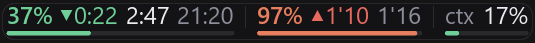

# ccd-usage-monitor



A floating one-line readout for Windows 10/11: how much of your Claude Code
quota is gone, and how full the current session's context window is. Aimed first
at the Claude Code **desktop** app, which shows neither and does not run the
status line the terminal client reports them through. Native Rust + Slint, one
executable, no web stack — and the whole appearance is a `.slint` file you can
edit without a compiler.

```
24% ▼0:42 3:19 20:49 │ 41% ▲1'9 4'7 │ ctx 38%
```

| Field | Meaning |
|---|---|
| `24%` | share of the rolling 5-hour limit already spent — or what is left of it, per `pct_mode` |
| `▼0:42` | pace, next to the figure it qualifies: spending is 42 minutes *behind* an even burn of the window, so there is headroom; `▲` is the other way. `pace_view` picks the form — this gap in time, the ratio (`▼1.2×`), the gap in points (`▼14%`), both of the last two, or neither |
| `3:19` | time left until that window resets |
| `20:49` | local clock time of the reset |
| `41%` | share of the weekly limit spent, under the same setting |
| `▲1'9` | the same pace figure for the weekly window: a day and nine hours ahead of an even burn (`▲1d9h` with `pace_form = units`) |
| `4'7` | time left until the weekly window resets: four days and seven hours (`4d7h` with `days_form = units`), or with `days_by = calendar` whole calendar days (`5d`), which of them count being a setting |
| `20%` | off by default (`show_week_allowance`): how much of the weekly limit may be spent per day to finish exactly at the reset — the remainder divided by the day count beside it, so by time half a day and 40% left reads `80%` |
| `ctx 38%` | how full the session's context window is — the share, the token count (`309k`), or both, per `ctx_view` |

Under each group a hairline track shows the same figure as a bar, so switching
to "left" makes the bars drain instead of fill. Colour never switches with them:
green through amber to red is keyed on spending either way. `bar_colour = pace`
keys it on the pace instead, which is a different question — a full bar and a
bar about to overflow are not the same thing — and then a short red bar means
quota left with no time to spend it in.

Point at a figure and a small box under the pill names it — `Until the 5-hour
limit resets`, `Weekly limit pace` — and says what it is right now: the date and
hour of the reset under the day count, what the pace means in words and in all
three units, the other reading of a percentage and where it came from. The bars
are covered too. With the detail panel already open the hint goes in it as the
first lines instead, so one hover never opens two surfaces.

Pace is coloured on a scale of its own: green only while spending is at or
under the clock, and orange deepening to red the moment it is over. There is no
green above the line — a ramp that starts there makes "just over" look like
"fine" — and the word in the panel switches at the same point, so `pace_tolerance`
now only separates "on pace" from a real surplus on the safe side.

The detail panel prints both readings at once (`62% spent · 38% left`), both
pace figures with the word for them, and, from the widget's own log of past
readings, how fast the quota is actually going and where that ends:

```
5h  9% left · 91% spent · resets Sat 08:00 · ▲2.5× 14% over pace · 20%/h · runs out 07:19, 0:42 before the reset · usage API
7d  58% left · 42% spent · resets Tue 10:00 · ▼1.3× 8% under pace · 17%/day · lasts to the reset · usage API · 19%/day allowed
```

That log lives in `samples.json` beside `config.toml`, holds eight days, and is
seeded at startup from the Claude desktop app's own `plan-usage-history.json`,
so the rate is answerable on the first minute rather than after an hour of
watching. The seeding is not tied to the **Desktop app** source switch: that
switch decides whose figures are shown now, while this is a one-off read of a
file already on disk.

Right-clicking the pill opens the settings in a window of their own — pages of
cards for the sources, the quotas, the context figure, pace and thresholds,
appearance and the system (see *Settings*) — and the tray icon opens the same
window, which is the way in when clicks fall through the pill. Under every
setting stands the first sentence of what it actually does, and the whole of
it floats up on hover.

The detail panel under the pill is sized to its longest line and appears
according to `detail_mode`: with the settings window, on hover, or never (the
default). Near an edge of the screen it opens upwards or leftwards instead of
pushing the pill out of place. Each of its lines says one thing once: the window
lines name the source a figure came from, and how old each source is appears on
the `src` line below them.

Figures that stop being refreshed grey out after 15 minutes, with an amber dot
on the pill, and disappear entirely after an hour — a stale percentage is not a
slightly-old number, it is a different window.

## What it needs to work

- **Windows 10/11**, and a Rust toolchain to build it: there is no release
   binary yet (`cargo build --release`, below).
- **A Claude Pro or Max subscription.** API-key users get no rate-limit
   figures at all.
- **Nothing else, for the basic figures.** With the Claude desktop app in use,
   the five-hour and weekly percentages come from the app's own history file and
   the context figure from the conversation transcripts. Neither needs a token
   or a setting. That file is written only about every fifteen minutes and has
   no reset times, so on its own the countdowns read `--:--`.
- **The Claude Code CLI, installed and signed in, for fresh figures and reset
   times.** The usage endpoint is asked with the CLI's token from
   `~/.claude/.credentials.json`. The desktop app keeps its sign-in elsewhere, so
   on a machine used only through the app that token goes stale. The widget asks
   the CLI to renew it by itself (`claude -p /usage`, which spends no quota), but
   when the CLI has dropped its session altogether only a new sign-in helps:
   run `claude auth login` in a terminal. On the author's machine that has been
   needed about once a day. The pill then shows dashes, and the detail panel
   and `--sources` say "signed out".
- **One terminal session of `claude`, once**, for the exact size of the context
   window: only the status line states it, and it is remembered per model.
   Without it the size comes from a table by model name.
- **Optional, the mods** (`CLAUDE_CODE_PLUGIN_DIRS`, see *In the desktop app*):
   `mod/` feeds the widget from inside desktop sessions, the window's size
   included, and `turn-meter/` draws the cost of each turn under the reply.

## Install

```
cargo build --release
```

That is the build to install and to point the status line at. It is also the
slowest by far — whole-program LTO on one codegen unit — so while working on
the code there are two others:

| Command | What for | Binary |
|---|---|---|
| `cargo check` | type-check only, nothing to run | — |
| `cargo run -- --demo` | debug build, quick to rebuild | `target/debug/` |
| `cargo run --profile quick -- --demo` | optimised, no LTO; the one to try the widget in | `target/quick/` |
| `cargo build --release` | what is installed and what the status line runs | `target/release/` |
| `cargo test` | the tests | — |

`--demo` shows synthetic figures that hold still; leave it out to see the real
ones. Only one copy of the widget should run at a time, and a running copy
locks its own `.exe`, so close it before rebuilding that profile.

Working on the code, enable the checks a commit has to pass — `cargo fmt`,
`cargo clippy` with no findings, and the docs linter where it is available:

```
git config core.hooksPath tools/hooks
```

Then point Claude Code's status line at the same binary, in
`~/.claude/settings.json`:

```json
"statusLine": {
  "type": "command",
  "command": "C:/path/to/ccd-usage-monitor/target/release/ccd-usage-monitor.exe --bridge"
}
```

Forward slashes are required: on Windows Claude Code runs the status-line
command through Git Bash, which eats unescaped backslashes and then fails
silently.

### In the desktop app

The desktop app never runs a status line. The Claude Code mod in `mod/` does
that job instead. It hands the session's quota and context figures to
`--bridge`, and it can pin the pill's line under the prompt. That line is off by
default (`showLine`): since Claude Code 2.1.295 it lands on a row of its own
under the model picker and takes height from the transcript. To load the mod in
every session, add this to `~/.claude/settings.json` and start a new session:

```json
"env": {
  "CLAUDE_CODE_PLUGIN_DIRS": "C:/path/to/ccd-usage-monitor/mod"
},
"pluginConfigs": {
  "ccd-usage-monitor": {
    "options": { "exe": "C:/path/to/ccd-usage-monitor/target/release/ccd-usage-monitor.exe" }
  }
}
```

`exe` must name a build that knows `--line`. Without it the mod takes the
executable from the status-line command above. In a terminal session the mod
stays quiet, because the status line already does both jobs there.

### The line under each reply

`turn-meter/` is a second mod, independent of the widget: under each reply in
the desktop app it draws a dim line with how full the context is
(`ctx 21% · 212k`), what share of the five-hour and weekly limits the turn cost,
and its dollars at API prices. The share is the turn's dollars over a price per
point that the mod learns from how the limits' readings move, model by model.
Tokens by kind, subagents, duration, requests, model and cache lifetime are
there too, each off by default and a switch in `pluginConfigs.turn-meter.options`.
`/turn-meter` prints the size of the windows and the learned prices. Load it the
same way, both folders in one variable separated by `;`:

```json
"CLAUDE_CODE_PLUGIN_DIRS": "C:/path/to/ccd-usage-monitor/mod;C:/path/to/ccd-usage-monitor/turn-meter"
```

Run `ccd-usage-monitor.exe` to show the widget. Its settings live in
`config.toml`, in a `settings` folder beside the executable unless `data_dir`
names another, existing folder (below); the theme, the state file and the
pill's remembered position (`window.json`) sit beside it and move with it. A
build run from the repository's `target\` uses the repository's own
`settings\`. Nothing is kept in `%APPDATA%`: a program started from a packaged
app such as Claude desktop sees a private copy of it. Put the executable in a
folder you can write to; where it cannot make `settings`, it falls back to the
temp folder.

## Settings

Right-click the pill, or use the tray icon, and the settings open in a window
of their own: five pages down its left side — **Limits**, **Context**,
**Appearance**, **Sources**, **System** — each a column of cards. A card is one
thing on the pill or one source, and it holds everything about that thing:
the pace card has whether each limit shows its pace, the form it takes and the
tolerance, and a source's card its switch, its expiry and its polling. Under
every setting's name stands the first sentence of what it does; the rest is in
a tooltip on hover.

The control follows the kind of value: a switch; a row of buttons for up to
three choices and a menu for more; a slider for percentages and plain counts;
a stepper for durations and token counts, whose ranges are too wide for a
track. Once clicked, a slider takes a small step from the wheel or `←`/`→`
and a big one from `PgUp`/`PgDn`; Shift makes a stepper's `−`/`+` the big
step. A double click on either puts the default back. A setting that only
matters while another one has some value stands indented under it, and greys
out or leaves the page when it has no effect.

Every change is written to `config.toml` at once, and the file is re-read
while the widget runs, so editing it by hand works just as well — comments and
key order survive a click in the window. The keys, page by page:

**Limits** — cards for the percentages, the pace, the five-hour reset, the
days to the weekly reset with the daily allowance, and the bars

| Key | Default | What it does |
|---|---|---|
| `pct_mode` | `spent` | whether the percentages and the bars count what is spent or what is `left`; the colour is keyed on spending either way |
| `warn_pct` | `69.0` | the spending at which a figure starts moving from green to amber |
| `danger_pct` | `89.0` | the spending at which it moves from amber to red, reaching full red at a hundred |
| `pace_view` | `time` | the form of the pace figure: `ratio` (`▲2.0×`), `points` (`▲9%`), `time` (the gap in the window's time: `▲0:27` on the 5-hour window at 3 min a point, `▲3d2h` on the weekly one, or `▲3'2` with `pace_form = short`), `ratio_points`, `points_ratio`, `split` (both, with a drawn rule between them), `piped` (`▲9%\|2.0×`, run together with a grey pipe) or `off` |
| `pace_form` | `short` | how the weekly pace reads in the `time` form: `units` (`▲3d2h`) or `short` (`▲3'2`, days and hours around `weekly_sep`; `colon`, the old name, still reads); the five-hour pace is `h:mm` either way, and the detail panel always spells it out |
| `pace_tolerance` | `7.0` | how many points under the clock still count as on pace; over the clock is over, and starts at orange |
| `show_5h_pace`, `show_5h_left`, `show_5h_clock` | `true` | whether the pill carries the five-hour pace, the time to its reset (`3:19`) and the clock time of the reset (`20:49`); the percentage is always there. The pill only — the status line and the detail panel keep every figure |
| `show_5h_now` | `false` | the local time now (`14:07`), last in the five-hour group — for a screen whose taskbar clock is hidden. Never greyed: it is this machine's clock, not a reading |
| `show_week_pace`, `show_week_days`, `show_week_allowance` | `true`, `true`, `false` | the same for the weekly window: its pace, the days to its reset (`5d`) and the daily allowance (`20%`) |
| `days_by` | `time` | how the weekly days are counted: `calendar` (whole days, `count_today` and `count_reset_day` decide the ends) or `time` (the exact time to the reset, `4d7h`, and the allowance divides by it) |
| `days_form` | `short` | how the count by time reads: `units` (`3d16h`) or `short` (`3'16`, days and hours around `weekly_sep`; `colon`, the old name, still reads); ignored by calendar |
| `weekly_sep` | `'` | what stands between days and hours in the short form of both weekly figures — any text up to three characters; empty is `'`. A colon works, but reads like the five-hour `h:mm` |
| `weekly_pad` | `false` | the hours of the short form always as two digits, `2'07`, rather than as few as they need, `2'7` |
| `count_today` | `false` | by calendar only: whether today counts towards the day figure and the allowance |
| `count_reset_day` | `true` | by calendar only: whether the day the quota resets counts — switch it off when the reset is in the morning |
| `bar_colour` | `fill` | what a bar's colour means: `fill` for how spent it is, `pace` for how fast it filled |

**Context**

| Key | Default | What it does |
|---|---|---|
| `ctx_view` | `pct` | the form of the `ctx` group: `pct` (`14%`), `tokens` (`142k`), `pct_tokens`, `tokens_pct`, or `off` |
| `ctx_dir_linked` | `true` | whether the `ctx` percentage and token count share one direction, or are set separately below |
| `ctx_pct_dir` | `spent` | the direction of the `ctx` percentage: `spent` or `left`. Independent of `pct_mode` — a window fills, it does not drain like the two quotas |
| `ctx_tokens_dir` | `spent` | the direction of the `ctx` token count; only read when `ctx_dir_linked = false` |
| `session_pick` | `live` | which session the context figure is about: `live`, `freshest`, or `pinned` |
| `session_id` | `""` | the conversation pinned, when `session_pick = "pinned"` — chosen from the list of conversations on this page, not typed |
| `session_scan_secs` | `30` | how often the transcript tree is enumerated again |
| `ctx_limit` | `learned` | how the context percentage gets its denominator: `learned` (the size the status line stated for that model, the table underneath), `table` (by model name only), `fixed` |
| `ctx_limit_tokens` | `1000000` | the denominator when `ctx_limit = "fixed"`, clamped to 8 192 … 1 000 000 |

**Appearance**

| Key | Default | What it does |
|---|---|---|
| `scale` | `1.22` | multiplies every size the theme sets — fonts, height, paddings — from 0.6 to 3.0. The knob to reach for when the widget moves to another monitor |
| `opacity` | `1.0` | how solid the background of the pill and the panel is, from 0.3 to 1.0; the text stays as it is |
| `anchor` | `right` | which edge of the pill stays put when its width changes (9% becoming 10%, a figure switched on): `left` grows it rightwards, `right` grows it leftwards, for a pill parked against the right of the screen |
| `detail_mode` | `never` | when the detail panel shows: `with_settings`, `hover`, `never` |
| `pace_rate` | `true` | the observed rate and the forecast in the detail panel |
| `detail_all_sources` | `false` | a line per enabled source in the detail panel — what `--sources` prints |

The rows under `anchor` are the detail panel's card. The same page shows where
the theme file is and opens it.

**Sources**

| Key | Default | What it does |
|---|---|---|
| `bridge_enabled`, `api_enabled`, `desktop_enabled`, `session_enabled` | `true` | the four sources, each an independent switch: the status line, the usage endpoint, the desktop app's history and the conversation transcripts (see *Where the numbers come from*) |
| `bridge_stale_secs`, `api_stale_secs`, `session_stale_secs` | `900` | how long a source's figures stay current; past it they go grey and the pill shows an amber dot |
| `desktop_stale_secs` | `1800` | the same for the desktop app's history, allowed twice as long because it is only written every quarter of an hour |
| `api_interval_secs` | `90` | how often the endpoint is polled in the background |
| `api_budget_per_min` | `6` | requests per rolling minute the widget allows itself; past it a request waits a few seconds rather than being dropped |
| `drop_after_secs` | `3600` | after this a reading is not shown at all rather than merely greyed: a five-hour figure from an hour ago is a different window |

**System**

| Key | Default | What it does |
|---|---|---|
| `click_through` | `false` | the pill stops taking the mouse and clicks go to whatever is underneath; turn it back from the tray menu |
| `lang` | `en` | the language of the labels and the detail panel: `ru` or `en` |
| `data_dir` | `""` | empty is the usual place; naming a folder moves `config.toml`, `theme.slint` and everything else this program keeps for itself there, and restarts the widget. Useful when the usual place is not directly editable (A28) |

The same page opens `config.toml` and restarts the widget. One key has no row
anywhere: `demo` (`false`), the synthetic figures `--demo` also gives, which
is a switch for working on the layout rather than a setting for using it.

### Sizes are the theme's

`scale` and `opacity` are all that is left of the look in the config. Every
other size — the pill's height, the thickness of the bars, the paddings above
and below the figures, the gaps between them, the corner radius, the font
sizes — is a named property near the top of `theme.slint`, in the same folder
as `config.toml`: `pill_height`, `corner`, `track_height`, `pad_x`,
`cell_gap`, `rule_gap`, `group_gap`, `pad_top`, `gap_text_bars`,
`pad_bottom`, `font_pct`, `font_time`, `font_small`, `font_arrow`, and the
detail panel's own `corner`, `font` and `gutter` further down. Each is written
as a multiple of `scale`, so the one knob still moves them all. The file is
written from the built-in default, `themes/pill.slint` in this repository, the
first time the widget runs; see *The look is a file* for what editing it
involves.

The keys that once held these sizes in the config — `font_pct`, `font_time`,
`pill_height`, `track_height`, `pad_top`, `gap_text_bars`, `pad_bottom`,
`gaps_x`, `corner_radius` — are ignored now, and dropped from the file the
next time the widget writes it.

## Modes

| Command | What it does |
|---|---|
| `ccd-usage-monitor` | the widget |
| `ccd-usage-monitor --demo` | the widget on synthetic data, for working on the layout |
| `ccd-usage-monitor --bridge` | status-line mode: reads one JSON payload on stdin, updates the state file, prints the same line for the terminal |
| `ccd-usage-monitor --print` | prints the current line and exits |
| `ccd-usage-monitor --line` | prints the pill's own line as plain text and exits; `--session <id>` for that conversation's context. What the mod pins in the desktop app |
| `ccd-usage-monitor --probe-api` | one request to the usage endpoint, printed raw |
| `ccd-usage-monitor --sources` | what each source reports right now, side by side |
| `ccd-usage-monitor --sessions` | every conversation on disk, what it reports, and which one is picked |

## Where the numbers come from

Four sources, each an independent switch.

**The desktop app's history** — `%APPDATA%\Claude\plan-usage-history.json`. The
Claude desktop app appends its own usage sample there roughly every fifteen
minutes: `{"t": <epoch ms>, "org": "<uuid>", "u": {"fh": 8, "sd": 19}}`, where
`fh` and `sd` are the five-hour and seven-day percentages. It asks nothing of
you — no token, no session, no status line — and it is the source that keeps
working when everything else lapses. It carries no reset times, so on its own
the countdowns read `--:--`.

**The bridge** — Claude Code passes its status-line command a JSON payload with
`rate_limits.five_hour`, `rate_limits.seven_day`, `context_window` and the
model's id. `--bridge` folds each payload into `state.json` beside `config.toml`,
and the widget watches that file. This is the documented path, and the only one
that states the *size* of the context window outright — which is why one
terminal session is worth running even if you work in the desktop app: the size
is remembered per model and used by the transcript reader afterwards. Note that
the status line is a feature of the *terminal* client: the desktop app appears
never to run it. There, the mod in `mod/` feeds the bridge with the same JSON
instead, the window's size included (see *In the desktop app*).

**The session transcripts** — `~/.claude/projects/<encoded-cwd>/<uuid>.jsonl`,
the conversation files Claude Code writes for itself, whichever client is
running. The last assistant line of one carries the token counters, and their
sum is what sits in the context window:

```json
{"type":"assistant","message":{"model":"claude-opus-5","usage":{
  "input_tokens":2,"cache_creation_input_tokens":817,
  "cache_read_input_tokens":88139,"output_tokens":569}}}
```

`input_tokens + cache_creation_input_tokens + cache_read_input_tokens` — the
same three counters, and not the output, that Claude Code's own status-line code
divides. This is the only source of a context figure that works in the desktop
app, where the status line never runs.

What it cannot know is the *denominator*. The size of a model's window comes
from a catalogue fetched from the server, and nothing on disk records it, so
`ctx_limit` decides: the size the status line stated for that model if one ever
did, a small built-in table by model name otherwise (the 5-series has a
million-token window, everything before it two hundred thousand), or a number
you set by hand. Getting this wrong is not a rounding error — the same 88 958
tokens are 9 % of a million and 44 % of two hundred thousand — so the detail
panel prints the whole division and marks a guessed denominator `(guessed)`,
`ctx_view` can put the raw token count on the pill beside the percentage, and a
reading larger than the assumed window raises it rather than pinning at 100 %.

A context window fills toward its limit; the 5-hour and weekly quotas drain
from theirs. Reusing `pct_mode` for `ctx` would make one of the two figures
wrong on every pill where the other is set to taste, so `ctx` keeps its own
direction — `ctx_pct_dir` for the percentage, `ctx_tokens_dir` for the count,
`ctx_dir_linked` for whether the two follow each other or are set apart.

`session_pick` says which conversation is reported: `live` reads the freshest of
those Claude Code currently lists in `~/.claude/sessions` — and stays quiet when
none is running, rather than falling back to a finished one; `freshest` takes
whichever transcript was written to last; `pinned` takes the one you chose in
the settings window. `ccd-usage-monitor --sessions` prints the same list with the figure
each one would report.

**The usage endpoint** — `https://api.anthropic.com/api/oauth/usage` with the
OAuth token from `~/.claude/.credentials.json`. Exact percentages *and* reset
times, with no session open. It is undocumented — a community discovery — and
the access token is short-lived; ccd-usage-monitor only ever reads that file and never
refreshes the token, so when it expires the endpoint goes quiet until Claude
Code is run again. The widget says so in the detail panel and carries on with
the other two.

Each source is a switch of its own (`bridge_enabled`, `api_enabled`,
`desktop_enabled`, `session_enabled`), and whatever is switched on is merged
field by field: the percentage from whichever source read it last, the reset
time from whichever source has one. That pairing matters — a reset time is an
absolute moment, so an hour-old reading of it is still correct, while a
percentage from the same reading is not.

The context figure merges the same way, and for the same reason: the fill comes
from the newest reading, the window's size from whichever source was told it.
So one terminal session is enough to teach the widget how big a model's window
is, and every transcript read afterwards stops guessing — even in the desktop
app, which never runs a status line at all.

Each source also has its own staleness threshold (`*_stale_secs`), because they
age differently: 15 minutes for the endpoint and the status line, 30 for the
desktop history, which is only written every quarter of an hour.

Background polling of the endpoint is deliberately slow (`api_interval_secs`,
90 s by default). Responsiveness comes from wake-ups instead: the poller goes
immediately on startup, on switching a source, on "refresh now", and whenever
the desktop app writes a new sample.

Both are shown and edited as `m:ss` — a 150-second interval reads `2:30`, not
"2 min". The endpoint rate-limits, so ccd-usage-monitor keeps a budget of its own —
`api_budget_per_min`, six by default. Past it the poller waits a few seconds
and then makes the request anyway, which is a far better deal than the minutes
a real 429 costs.

## The look is a file

The pill's whole appearance — palette, type, paddings, corner radius, the
thickness of the bars — is `theme.slint`, written to the settings folder
(or `data_dir`) the first time the widget runs. The settings that matter most sit
near the top: the palette (`palette_green`, `palette_amber`, `palette_orange`,
`palette_red`, `palette_ink` for the figures, `palette_dim` for the faint ones),
the font sizes (`font_pct`, `font_time`, `font_small`, `font_arrow`), the gaps
(`pad_x`, `cell_gap`, `rule_gap`, `group_gap`), the pill's background
(`rgba(19, 19, 22, …)` in the card) and the typeface (`font-family: "Segoe UI"`). Edit it and use "Перезапустить" / "Restart" in the tray or the settings
window; no Rust toolchain is involved.

What the theme does **not** decide is deliberate: the wording and the figures
arrive already worked out, which colour a figure gets is decided by what it
means rather than by the file, and the window's behaviour — frameless, on top,
click-through — is applied by the program. A broken theme falls back to the
built-in copy and says what was wrong; it cannot produce a window you are
unable to close.

## Built with Slint

This application uses [Slint](https://slint.dev) under its royalty-free
licence, which asks that the use be visibly acknowledged. It is: in the
settings window, and in the tray menu.

## Licence

MIT — see [LICENSE](LICENSE). Slint itself stays under its own royalty-free
licence, which this project does not change.
